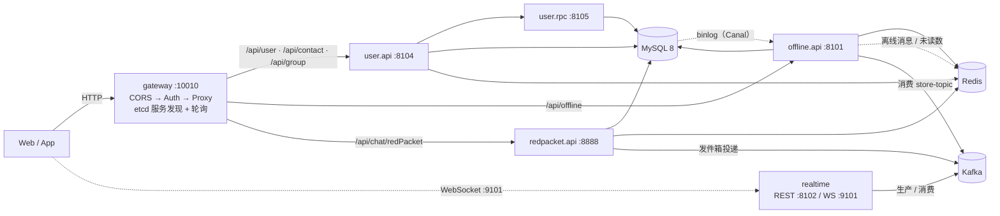

# 架构

## 1. 服务拓扑



`ai` 路由指向外部服务 `http://localhost:8886`，不属于本仓库。

## 2. 端口与协议

| 服务 | 端口 | 协议 | 说明 |
|---|---|---|---|
| gateway | 10010 | HTTP | 唯一对外入口 |
| user.api | 8104 | HTTP | 注册到 etcd：`/services/user.api` |
| user.rpc | 8105 | gRPC | 注册键 `user.rpc`，供 realtime / offline 调用 |
| realtime | 8102 / 9101 | HTTP / WebSocket | REST 健康检查；WS 路径 `/ws/chat` |
| offline.api | 8101 | HTTP | 注册键 `/services/offline.api` |
| redpacket.api | 8888 | HTTP | 注册键 `/services/redpacket.api` |

## 3. HTTP 请求链路

1. 客户端 → gateway，先过 CORS（`OPTIONS` 直接 204 返回）
2. Auth 中间件：URL 精确匹配白名单（`/api/user/login`、`/api/user/users`、`/api/user/sendCaptcha`）则放行；否则查 Redis `access_token:<token>` 得到 userId
3. **身份一致性校验**：路径里 `/users/{id}` 的 id 必须等于 token 主人，否则 403；然后删除客户端自带的 `X-User-Id`，写入可信值
4. Proxy：按 `Prefixes` 前缀匹配路由；`etcd://` 上游从 Resolver 轮询取实例
5. 下游服务：`RecoverMiddleWare` 兜住业务错误；`IdentityMiddleware` 把 `X-User-Id` 解析进 context；`SetErrorHandlerCtx` 统一成 `{code, message}`

细节见 [auth.md](auth.md)。

> 注意：会话维度的授权（`/api/group/{sessionId}/members`、`/api/offline/...`）仍由各服务自行判断，尚未统一；见 [roadmap.md](roadmap.md)。

## 4. 消息链路（IM 主流程）

### 发送（单聊）

```
客户端 --WS--> realtime
                 ├─ 生成 messageId（雪花）、补 createdTime
                 ├─ Push(store-topic)     → offline 消费 → 写 MySQL message 表
                 └─ KPush(message-topic, key=sessionId) → realtime 消费 → 推送
```

`key = sessionId` 的目的是让同一会话的消息落到同一分区，从而保证顺序。

### 落库与缓存

```
MySQL message 表 --binlog--> Canal(offline) --解析--> Redis:
  session:{sessionId}   ZSet   消息 JSON（score=毫秒时间戳，保留 7 天）
  session:active        ZSet   全局活跃会话榜
  user:{uid}            Hash   sessionId → 会话快照（最后一条消息摘要）
  user:{uid}:count      Hash   sessionId → 未读数
```

### 推送

- `realtime` 消费 `message-topic`，在**本节点**的连接表里找接收者
- 群聊先调 `user.rpc.GetGroupMemberIds` 拿成员列表，逐个推
- 接收者不在本节点时，依赖离线接口兜底（跨节点转发尚未实现，见 roadmap）

### 拉取

- 历史消息：`/api/offline/...` 先查 Redis（7 天内），不足再补 MySQL
- 离线消息：Redis `user:{uid}` / `user:{uid}:count` 提供会话快照与未读

## 5. Kafka topic

| topic | 生产方 | 消费方 | 用途 |
|---|---|---|---|
| `store-topic` | realtime、redpacket | offline | 消息落 MySQL |
| `message-topic` | realtime、redpacket | realtime | 在线推送 |
| `system-notification-topic` | user.api | realtime | 系统/业务通知推送 |
| `store-notification-topic` | realtime | offline | 用户离线时的通知落库 |
| `redpacket-creation-topic` | redpacket | redpacket | 过期扫描注册 |
| `topic-redpacket-receive` | redpacket | redpacket | 领取记录入账 |
| `topic-redpacket-completed` | redpacket | redpacket | 领完状态流转 |
| `redpacket-expiration-topic` | redpacket 扫描器 | redpacket | 过期退款 |

> `service/redpacket/.../constants` 里另有 `message-store-topic` / `message-push-topic` 两个常量，与上表并不一致且未被真正使用（只用于创建 Pusher），属于待清理项。

## 6. Redis key

| key | 类型 | 写入方 | 说明 |
|---|---|---|---|
| `access_token:<jwt>` | String | user.api 登录 | TTL 30 分钟，gateway 用它鉴权 |
| `refresh_token:<rt>` | String | user.api 登录 | TTL 7 天 |
| `user:refresh:<uid>` | String | user.api 登录 | 单点登录：登录时删旧 refresh token |
| `wsServerUri` | Hash | 登录 / realtime 连接 | uid → `ws://host:port/ws/chat` |
| `session:{sid}` | ZSet | Canal | 热消息，score=毫秒时间戳，保留 7 天 |
| `session:active` | ZSet | Canal | 活跃会话榜 |
| `user:{uid}` | Hash | Canal | sessionId → 会话快照 |
| `user:{uid}:count` | Hash | Canal | sessionId → 未读数 |
| `msg:validate:friend:status:<uid>:<fid>` | String | user.rpc | 好友状态缓存，TTL 120s |
| `redpacket:{id}:pool` | List | redpacket | 预分配金额池（分），LPOP 抢包 |
| `redpacket:{id}:records` | Hash | redpacket | userId → 领取金额，兼防重复领 |
| `redpacket-expire-zset` | ZSet | redpacket | member=红包ID，score=过期毫秒时间戳 |
| `cache:*` | String | go-zero | 各 model 的行缓存（默认 7 天） |

## 7. MySQL 表

| 表 | 用途 |
|---|---|
| `user` | 账号、资料、密码（MD5+盐，待升级） |
| `user_balance` / `balance_log` | 余额（分）与变动流水 |
| `friend` / `apply_friend` | 好友关系（含拉黑状态）与好友申请 |
| `session` / `user_session` | 会话（单聊/群聊）与会话成员（角色、状态） |
| `message` | 消息实体，`message_id` 主键（雪花），重复投递按 1062 幂等 |
| `system_notification` | 离线系统通知 |
| `red_packet` / `red_packet_receive` | 红包主表与领取记录 |

建表脚本：根目录 `IM.sql`，以及各 model 目录下的 `*.sql`。

## 8. 一致性策略

| 场景 | 做法 |
|---|---|
| 多表写入 | `txctx.WithTransaction` 包裹，事务 session 放进 ctx，model 的 `*Tx` 方法自动复用 |
| 业务错误与回滚 | `Throw` 抛 panic，`safeRun` 转 error 让事务回滚，外层再重新抛 |
| 缓存失效 | 非事务路径走 go-zero `ExecCtx`；事务路径需调用方在提交后显式删缓存 |
| Kafka 重复消费 | 幂等：消息表按主键 1062 跳过；红包领取按「红包+用户」唯一 |
| 红包退款 | 条件更新 `status: 0 → 2`，`RowsAffected == 1` 才退款（防并发重复退款） |

## 9. 已知架构级缺口

- 跨节点推送：`message-topic` 用全局消费组，消息只会被一个节点消费，接收者若在别的节点就丢
- 事务性发件箱：`Redis 改了 → 发 Kafka 失败` 的中间态没有闭环（红包领取、通知）
- 离线热/冷边界：补差额依赖「Redis 必留满 7 天」，否则出现空洞

详见 [roadmap.md](roadmap.md)。
