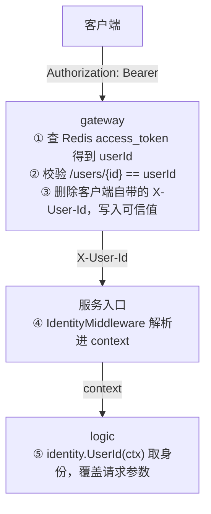

# 身份与鉴权

## 1. 三层结构



关键点：**身份只有一个来源**——网关注入的 `X-User-Id`。URL 路径与请求体里的 userId 只是"定位参数"，不再作为身份凭据。

## 2. 路径语义约定

`/users/{id}` 中**第一个** id 永远是"当前操作者"：

| 路径 | 操作者 | 说明 |
|---|---|---|
| `/api/user/users/123` | 123 | 查自己资料 |
| `/api/user/users/123/balance` | 123 | 查自己余额 |
| `/api/contact/users/7/friend/8` | 7 | 7 与 8 的关系；8 是对方，不参与身份校验 |
| `/api/group/users/9` | 9 | 9 加入的群 |

网关用 `/users/(\d+)` 取**第一次**出现的 id 做比较，因此 `createUserId` / `receiveUserId` / `friendId` 这类参数不会被误判。

没有 `/users/{id}` 段的接口（如 `/api/group/{sessionId}/members`、`/api/offline/...`）不做路径校验——这类接口的归属是"会话成员"，必须由服务端自行判断（见第 6 节）。

## 3. 各层代码

### 网关：写入与校验

`service/gateway/internal/middleware/auth.go`

```go
if isPathUserIdMismatch(path, userIdStr) {
    m.responseForbidden(w)   // 403 {"code":40300,"message":"无权访问他人的数据"}
    return
}
r.Header.Del(identity.HeaderUserId)      // 防伪造：先删客户端自带的
r.Header.Set(identity.HeaderUserId, userIdStr)
```

### 服务：解析进 context

`service/user/api/internal/middleware/identity.go`

```go
if raw := r.Header.Get(identity.HeaderUserId); raw != "" {
    if userId, err := strconv.ParseInt(raw, 10, 64); err == nil && userId > 0 {
        r = r.WithContext(identity.WithUserId(r.Context(), userId))
    }
}
```

只解析、不拒绝：白名单接口（登录/注册）本来就没有身份，中间件不能因为缺头就阻断。

### logic：以 ctx 身份为准

```go
if userId, ok := identity.UserId(l.ctx); ok {
    req.UserId = userId      // 覆盖路径/请求体里的值
}
```

没有身份时（直连服务调试）保留原参数，行为与改造前一致。

## 4. 当前覆盖范围

| 位置 | 状态 |
|---|---|
| 网关路径校验（覆盖所有 `/users/{id}` 接口） | 已上线 |
| 网关注入 + 删除伪造头 | 已上线 |
| `common/identity`（ctx 读写） | 已有测试 |
| `IdentityMiddleware`（下沉到 `common/middleware`，user.api / offline / redpacket 三服务共用） | 已注册 |
| 全部 user.api logic 以 ctx 身份为准（好友、申请、群、登出、改头像等 20+ 处） | 已迁移 |
| 群成员列表 / 群人数：`EnsureGroupMember` 会话归属校验 | 已上线 |
| offline 历史消息 / 离线消息：`ensureSessionMember` 会话归属校验 | 已上线 |
| redpacket 领取 / 发送：以 ctx 身份为准 + 禁止领自己的红包 | 已上线 |
| user.rpc 的内部调用鉴权（当前信任调用方传入的 senderId） | 未完成 |

## 5. 测试

| 用例 | 文件 |
|---|---|
| 路径 id 与 token 一致/不一致/缺段/非数字 | `service/gateway/internal/middleware/auth_test.go` |
| 403 响应体 | 同上 |
| 中间件解析合法/非法头、永不阻断 | `service/user/api/internal/middleware/identity_test.go` |
| ctx 读写、非法 ID 不写入、子 context 继承 | `common/identity/identity_test.go` |

## 6. 还没做的部分

1. **RPC 侧鉴权**：`user.rpc` 的调用方（realtime/offline）目前信任传入的 senderId。建议后续加内部鉴权（mTLS 或签名），因为内网服务之间的边界也可能被攻破。
2. **收口校验的下沉**：`EnsureGroupMember` / `ensureSessionMember` 目前只挡了成员列表、人数、历史消息、离线消息四个入口。群聊**发消息**的成员校验在 `user.rpc.ValidateGroupMessage` 里（属于另一条链路，见 [services.md](services.md)），需要确认两处口径一致（都过滤 `status=0`）。
3. **红包身份的回退**：`OverrideIfPresent` 在没有 `X-User-Id` 时保留请求参数（兼容直连调试），意味着"绕过网关直连服务"仍可能伪造。生产环境可改成 `MustUserId` 强制要求身份。
