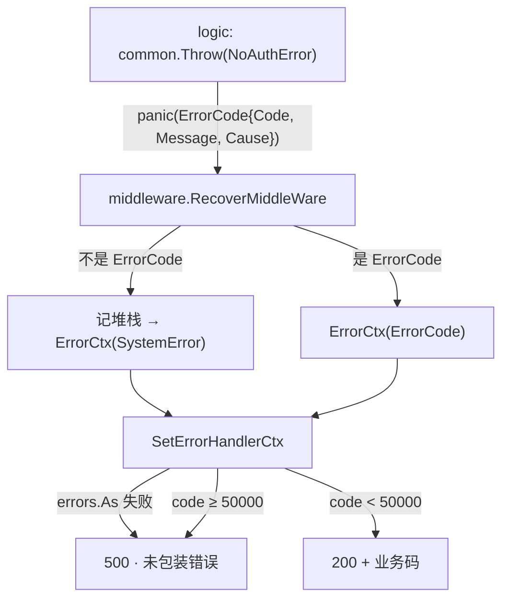

# 错误处理约定

本项目只有一套错误出口：`httpx.ErrorCtx` → `SetErrorHandlerCtx`。理解这一点，后面的规则都是推论。

## 1. 错误码分段

| 区间 | 含义 | 响应 |
|---|---|---|
| `40xxx` | 请求 / 认证 / 通用业务错误 | HTTP 200 + `{code, message}` |
| `42xxx` | 用户域业务错误（已存在、验证码错误等） | HTTP 200 + `{code, message}` |
| `50000` | **分界线**：>= 50000 视为系统故障 | HTTP 500 + 脱敏文案 |
| `50xxx` | 系统故障（Redis/MySQL/序列化/Kafka） | HTTP 500 + `系统内部异常` |
| `90xxx / 91xxx` | WebSocket / RPC 侧独立区间 | 不走 HTTP 错误处理器 |

## 2. logic 层只有两种合法写法

| 场景 | 写法 | 示例 |
|---|---|---|
| 有底层 err（系统错误，code >= 50000） | 记日志 + `return common.WrapError(common.SystemError, err)` | Redis 连接失败、SQL 执行失败 |
| 无底层 err（业务判断，code < 50000） | `common.Throw(common.XxxError)` | 账号格式错误、无权操作 |

**禁止**：

```go
return nil, err            // 裸错误：会被当成"未包装错误"记 500
common.Throw(common.SystemError)   // 有底层原因却不带，排障时无从下手
common.ThrowIfWithMsg(x, common.UserAlreadyExists, "用户ID不能为空")  // 错误码与语义不符
```

## 3. panic 的旅程



要点：

- `RecoverMiddleWare` 是**必需件**。删掉它，`Throw` 会变成"空响应体的 500"（go-zero 自带的 RecoverHandler 只记日志不写 body）。
- `ErrorCode.Error()` 只返回 `Message`。底层原因在 `Cause` 里，所以日志必须显式打 `bizErr.Cause`——本轮修复了这一点（此前 SQL 的 1054 永远看不到）。

## 4. 事务里抛错

`txctx.WithTransaction` 用 `safeRun` 把 panic 转成 error，让事务能回滚：

```go
err := txctx.WithTransaction(ctx, conn, func(ctx context.Context) error {
    _, err := model.InsertTx(ctx, data)          // 复用 ctx 里的 session
    common.ThrowIfWithMsg(err != nil, common.SystemError, "插入失败", err)
    return nil
})
common.ThrowIfWithMsg(err != nil, common.SystemError, "整体失败", err)   // 重新抛给 HTTP 层
```

注意：

- 事务里抛出的 panic 不会传到 HTTP 中间件，只会变成 `WithTransaction` 的返回值，**必须再次 Throw/return**，否则错误被吞。
- go-zero 的 `CachedConn.Insert/Update` **不读** ctx 里的 tx session。事务内必须用模型提供的 `InsertTx/UpdateTx/DeleteTx`。

## 5. 异步场景

```go
go func() {
    defer func() { if r := recover(); r != nil { common.Errorf(...) } }()   // 必须
    ... // 不要调用会 Throw 的函数，或在 defer 里兜住
}()
```

原因：goroutine 里的 panic 不会被 HTTP 中间件的 recover 接住，会直接崩溃整个进程。Kafka 消费（`kq` 用 `RoutineGroup.Run`，无 recover）同理。

另外，goroutine 里不要复用请求的 `ctx`：handler 返回后 ctx 会被取消，Kafka 推送/DB 查询会立刻失败。需要时用 `context.Background()` 加超时。

## 6. 排障清单

| 现象 | 先看哪里 |
|---|---|
| 接口 500 但没有细节 | 日志里搜"系统错误 <code>"，看 `原因:` 后面的底层错误 |
| 接口 500 且日志是"未包装错误" | 有人直接 `return err`，去 logic 层补 `WrapError` |
| 业务错误返回 500 | 错误码用了 `>= 50000` 的系统码 |
| 错误提示与场景不符 | 检查是否复用了错误码（例如把"用户ID无效"抛成 `UserAlreadyExists`） |
