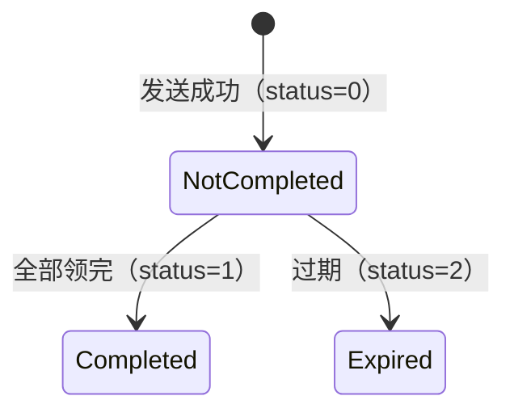

# 红包设计

红包是最能体现"分布式一致性"的模块：Redis 做原子抢包，MySQL 做账，事务发件箱（MySQL Outbox + Redis Stream）保证事件可靠投递，Kafka 做消息分发，定时器做过期退款。

## 1. 金额与单位

- 全部内部计算使用**分**（`int64`），只在展示层转成元。
- `YuanToFen` 用 `math/big.Rat` 精确解析，避免浮点截断少 1 分；超过两位小数直接报错。
- `ConvertFenToYuan` 用整数格式化（`fen/100` + `fen%100`），不用 float。
- 单份红包上限 `MaxSingleAmountYuan`，总额必须 ≥ 份数（每份至少 1 分）。

## 2. 金额拆分算法

`service/redpacket/api/internal/algorithm/redpacket_algorithm.go`

| 类型 | 做法 | 保证 |
|---|---|---|
| 普通红包（等额） | 总额 / 份数，余数分给前 `remainder` 份 | 每份 ≥ 1 分，总和精确 |
| 拼手气 | 线段切割法：在 `[0, 剩余额度]` 上随机取 `count+1` 个互异切点，相邻差值 +1 分；随机打乱 | 每份 ≥ 1 分，总和精确，无死循环 |

当 `剩余额度 < 份数`（退化为"几乎人人 1 分"）时切点法凑不齐点数，改用"随机挑人 +1 分"的兜底分支——这是历史 bug 修复点，有单测覆盖。

## 3. Redis 结构

| key | 类型 | 说明 |
|---|---|---|
| `redpacket:{id}:pool` | List | 预分配金额池（分），`LPOP` 原子领取 |
| `redpacket:{id}:records` | Hash | `userId → 领取金额`，兼作防重复领取 |
| `redpacket-expire-zset` | ZSet | `member=红包ID`，`score=过期毫秒时间戳` |

`pool` / `records` 的 TTL 为 25 小时——比 24 小时过期时间多 1 小时，保证过期处理跑完之后缓存才失效。

## 4. 发送流程

```
1. 参数校验（金额格式、>0、总额 ≥ 份数、单份 ≤ 上限）
2. 金额分配（普通=均分 / 拼手气=切点法，事务前纯 CPU）
3. MySQL 事务（原子）：
   - 扣减发送者余额
   - 插入红包主表（InsertTx）
   - 写余额流水
   - 写事务发件箱：store-topic / message-topic / pool-init 三条事件
4. 同步建池（幂等 Lua）：pool 写金额 + 登记过期 ZSet（快速路径，让红包立即可领）
5. 投递器异步：store/push 推 Kafka，pool-init 由投递器自处理（幂等重建金额池）
```

要点：

- 主表必须用 `InsertTx`——`CachedConn.Insert` 不走事务，回滚后留下孤儿红包。
- 消息事件与扣款同事务落库（事务性发件箱），Kafka 失败可重试。
- pool-init 事件也在事务里：同步建池失败时，投递器按事件异步重建，红包不会"领不了也退不了"。

## 5. 领取流程（Lua 原子 + Redis Stream 发件箱）

`ExecuteReceiveLua` 单脚本原子完成：防重复（`HEXISTS`）→ 过期判断（与 Redis `TIME` 比较）→ `LPOP` 取一份 → `HSET` 记录 → `LLEN` 判断是否领完 → **XADD 领取事件到 Redis Stream**（含 `completed` 字段）。

| 返回码 | 含义 | 客户端表现 |
|---|---|---|
| 正数 | 领取成功，值为金额（分） | 展示金额 |
| `-1` | 已领取过 | 返回原金额 + "您已经领取过" |
| `-2` | 已过期 | "红包已过期" |
| `-3` | 金额池空 | 查库返回真实状态 |

入账不走 Kafka：`LPOP + HSET + XADD` 在同一脚本里原子完成，不存在"抢到但事件丢失、钱不到账"的窗口。领取事件由 `receive_stream_worker` 消费入账；本次恰好领完（`completed=1`）时由 worker 推 `topic-redpacket-completed`。

> 历史 bug：`-1` / `-2` 分支漏了 `return`，会落到兜底的 `Throw(500)`，用户连点两次就报"系统内部异常"。已修。

## 6. 状态机



## 7. 异步落账

| 消费者 | 事件来源 | 职责 | 幂等/一致性 |
|---|---|---|---|
| `receive_stream_worker` | Redis Stream（领取事件） | `SettleReceive` 入账：幂等检查 → 事务（插领取记录 + 加余额 + 写流水）→ XACK | 幂等检查 + 唯一键 |
| `receive_stream_worker` | Redis Stream（`completed=1`） | 推 `topic-redpacket-completed` | 入账成功才推，失败不 XACK 下轮重试 |
| `CompletedConsumer` | Kafka | 状态置为已领完 + 清理缓存 | 状态判断 |
| `ExpirationConsumer` | Kafka（经发件箱） | 计算剩余金额 → 事务：**条件更新状态 0→2**（抢到迁移才退款）+ 退款 + 写流水 → 清缓存 | `RowsAffected == 1` 才退款 |

过期退款曾经是"先查状态、再无条件 UPDATE"，Kafka 至少一次投递 + 并发消费会把同一笔钱退两次。本轮改成条件更新，`RowsAffected` 为 0 就直接跳过。

## 8. 过期扫描（事务发件箱）

`internal/schedular/expiration_dispatcher.go`：每秒扫描过期 ZSet，用 Redis 锁做多实例互斥。

流程：`ScanExpiredRedPacketsLua` **只 `ZRANGEBYSCORE` 不摘** → 对每个过期 ID `INSERT IGNORE` 写发件箱（`dedup_key=expire:<id>`）→ 登记成功后才 `ZREM` 摘除 → 投递器推 `redpacket-expiration-topic` → `ExpirationConsumer` 退款。

退款金额：优先 Redis pool 剩余（`LRANGE` 求和）；**pool 缺失（TTL 过期）时改用 DB 差额** `TotalAmount − SUM(领取金额)`，不依赖 Redis 存活。

已知问题（见 [roadmap.md](roadmap.md)）：
- 锁 TTL（1s）短于单轮预算（5s），互斥可能中途失效
- `LRANGE 0 -1` 全量累加剩余金额，大包会阻塞 Redis（待改 O(1) 读）

## 9. 已知缺口

- **发红包无幂等**：`clientMessageId` / `PreventDuplicatePrefix` 已定义未使用，重复提交会重复扣款
- `records` Hash 的 TTL 设置时机不对（对尚不存在的 key 做 EXPIRE 无效），可能长期驻留
- 已闭环：LPOP 后事件丢失（Redis Stream 发件箱）、过期扫描先摘后投丢失 ID（Outbox）、`InitRedisPool` 失败（pool-init 进事务）、退款依赖 Redis TTL（DB 差额兜底）
